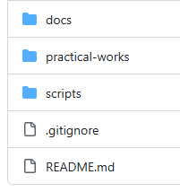
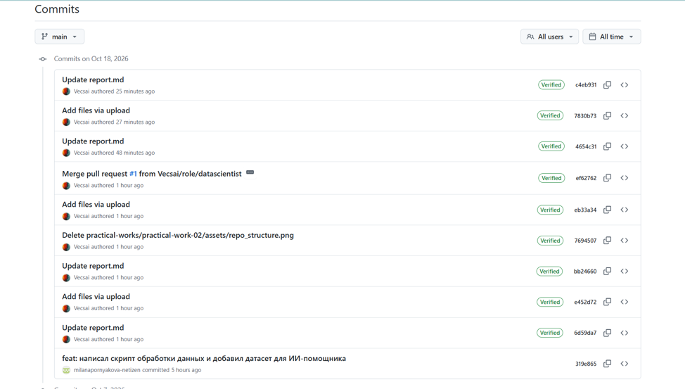
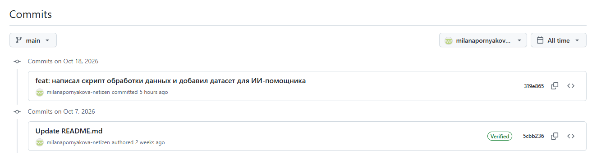
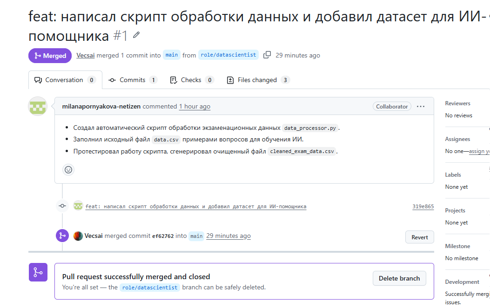

# Отчёт по самостоятельной работе №2

**Тема:** Организация работы с репозиторием проекта и распределение ответственности в Git.
**Команда:** <Название вашей команды>
**Ссылка на репозиторий:** https://github.com/<логин_руководителя>/team-<название_команды>-project

---

## 1. Подтверждение регистрации всех участников на GitHub

Все участники команды успешно зарегистрировались на платформе GitHub.

| Роль в команде | ФИО | Логин на GitHub |
| :--- | :--- | :--- |
| Руководитель разработки ПО | @Vecsai |
| Архитектор ПО | @Sasha010142 |
| Программист | @mks6723|
| Специалист по тестированию | @Danil-Popkov |
| Специалист по данным | @milanapornyakova-net|
| Исследователь | @Vecsai|

---

## 2. Ссылка на созданный командный репозиторий

Репозиторий создан по адресу: 
🔗 **[Реопзиторий](https://github.com/Vecsai/team-Exa-Mind-project)**

---

## 3. Скриншот структуры репозитория

Репозиторий организован строго по заданной структуре. Ниже представлено дерево папок и файлов.

---

## 4. Распределение обязанностей по работе с репозиторием (на основе СР1)

На основе RACI-матрицы из первой самостоятельной работы, обязанности в Git распределены следующим образом:

*   **Создание и настройка репозитория:** R — Руководитель, Архитектор ПО; A — Руководитель.
*   **Поддержание структуры папок и файлов:** R — Все участники (каждый в своём разделе); A — Руководитель.
*   **Написание отчётов по практическим работам:** R — Все участники согласно своим ролям; A — Руководитель.
*   **Внесение коммитов с осмысленными сообщениями:** R — Каждый участник за свои изменения; A — Руководитель.
*   **Проверка Pull Request:** R — Руководитель, Архитектор, Специалист по тестированию; A — Руководитель.
*   **Слияние веток (merge):** R — Руководитель; A — Руководитель.
*   **Резервное копирование и поддержание актуальности:** R — Все участники; A — Руководитель.

> *(Кратко можно указать, кто именно что делал: Исследователь заполнил docs/, Программист — src/ и т.д.)*

---

## 5. Скриншоты истории коммитов с указанием авторов

Каждый участник вносил изменения в свою ветку и делал коммиты. В истории чётко видны авторы изменений.

История коммитов от @milanapornyakova-net

---

## 6. Скриншоты созданных Pull Request и процесса ревью

Каждый участник создал свой Pull Request. Другие участники проводили ревью (проверку) и оставляли комментарии / одобряли изменения.

Список Pull Request от @milanapornyakova-net

---

## 7. Вывод

Использование системы контроля версий Git и платформы GitHub позволяет эффективно организовать командную работу. Работа через отдельные ветки (branch) исключает конфликты и порчу чужих файлов. Инструмент Pull Request позволяет проводить проверку кода и текстов (ревью) перед попаданием в основную ветку main. 
Главное преимущество — **прозрачность**. Благодаря истории коммитов и указанию авторов, можно точно отследить вклад каждого участника команды, что делает оценку работы объективной.

---
# Контрольные вопросы

### 1. Что такое репозиторий и для чего он нужен?
**Репозиторий** — это хранилище проекта, в котором содержатся все файлы, папки и полная история изменений. Он нужен для централизованного хранения материалов, отслеживания версий файлов, организации совместной работы команды и фиксации вклада каждого участника.

### 2. Какие преимущества даёт использование Git при командной разработке?
* **Параллельная работа:** каждый участник может работать над своей задачей в отдельной ветке, не мешая остальным.
* **История изменений:** можно в любой момент посмотреть, кто, когда и что изменил.
* **Безопасность (откат):** возможность вернуться к предыдущей рабочей версии проекта, если что-то сломалось.
* **Контроль качества:** изменения попадают в общий проект только после проверки (ревью).
* **Распределённость:** у каждого участника есть полная локальная копия репозитория.

### 3. Что такое коммит и каким правилам должно соответствовать сообщение коммита?
**Коммит** — это зафиксированное состояние файлов в репозитории (сохранение изменений). 
Сообщение коммита должно соответствовать следующим правилам:
* **Краткость и ёмкость:** отражать суть изменения (что именно сделано).
* **Осмысленность:** избегать сообщений вроде «fix», «update», «изменения».
* **Использование префиксов (желательно):** например, `feat:` (новая функция), `fix:` (исправление), `docs:` (документация), `test:` (тесты).
* **Повелительное наклонение:** например, «добавить», «исправить», а не «добавил», «исправил».

### 4. В чём разница между веткой (branch) и основной веткой (main/master)?
* **Основная ветка (`main`/`master`)** — это стабильная, «чистовая» версия проекта, которая всегда должна работать. Прямые изменения в неё обычно запрещены.
* **Ветка (`branch`)** — это изолированная копия проекта для работы над конкретной задачей (новой функцией, исправлением). Участник вносит изменения в свою ветку, не ломая основной проект, а затем предлагает их добавить в `main`.

### 5. Что такое Pull Request и как он связан с распределением ответственности?
**Pull Request (PR)** — это запрос на слияние изменений из личной ветки участника в основную ветку (`main`). 
**Связь с ответственностью:** PR — это инструмент контроля. Автор изменений (роль **R**) предлагает свою работу, а проверяющий (ревьюер или руководитель, роль **A**) проверяет качество, оставляет комментарии и принимает решение о слиянии. Это гарантирует, что в общий проект не попадут ошибки.

### 6. Как через историю коммитов можно определить вклад каждого участника команды?
Каждый коммит в Git имеет автора (имя и email, привязанные к аккаунту GitHub). Через историю коммитов (вкладка **Commits** на GitHub или команда `git log`) можно увидеть:
* Кто именно сделал коммит.
* Какие файлы он изменил и сколько строк добавил/удалил.
* Когда это было сделано и с каким сообщением.
Это позволяет объективно оценить объем и качество работы каждого.

### 7. Почему перед началом работы требуется регистрация на GitHub?
Регистрация необходима для:
1. Создания уникального профиля (логина), который будет связываться с коммитами участника.
2. Получения доступа к общему командному репозиторию (через добавление в Collaborators).
3. Использования инструментов совместной работы: создание Pull Request, оставление комментариев и ревью, управление задачами (Issues).
Без аккаунта невозможно авторизоваться в облачном репозитории и зафиксировать свой вклад.
